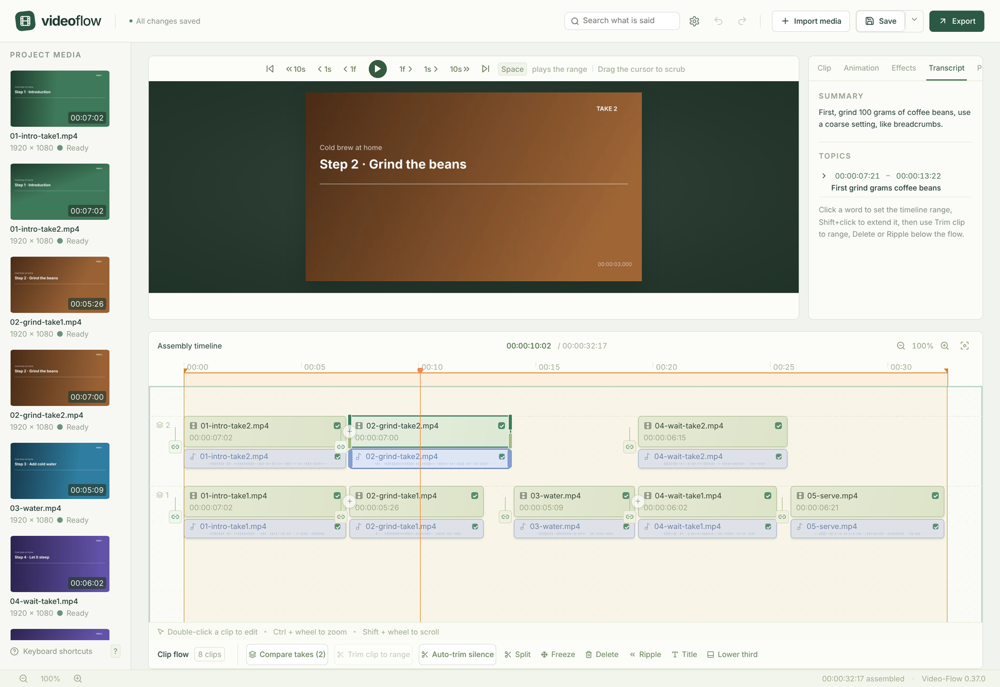
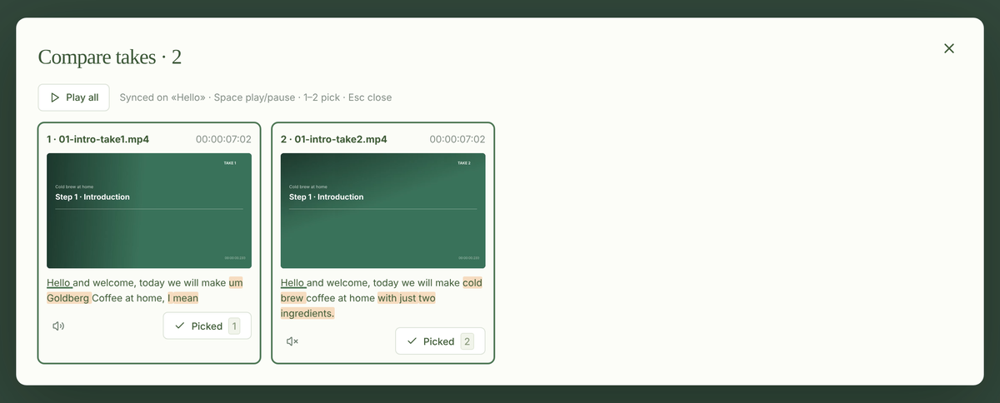
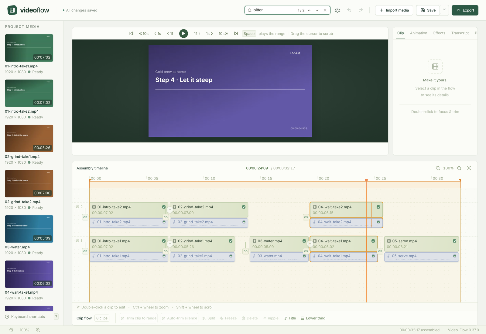
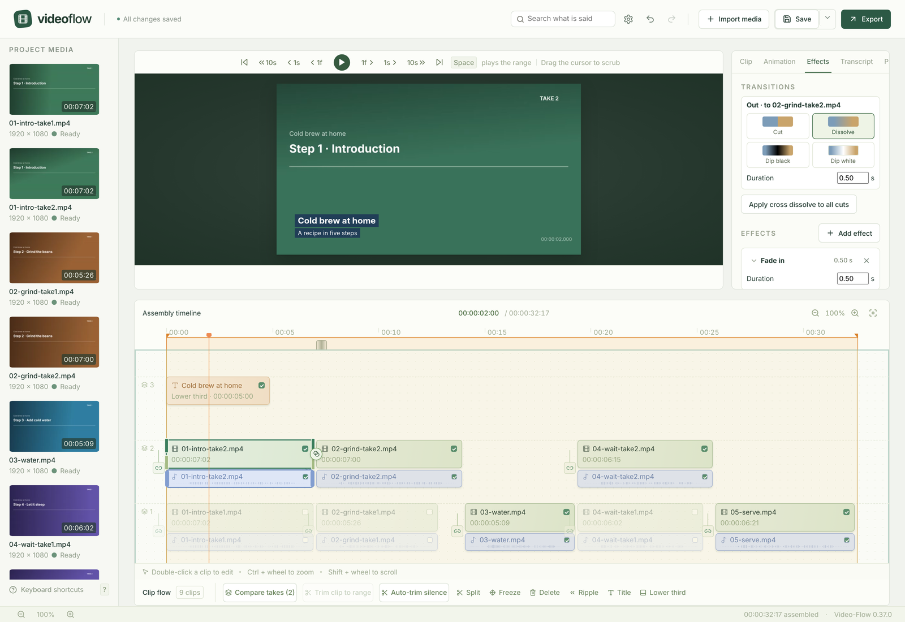
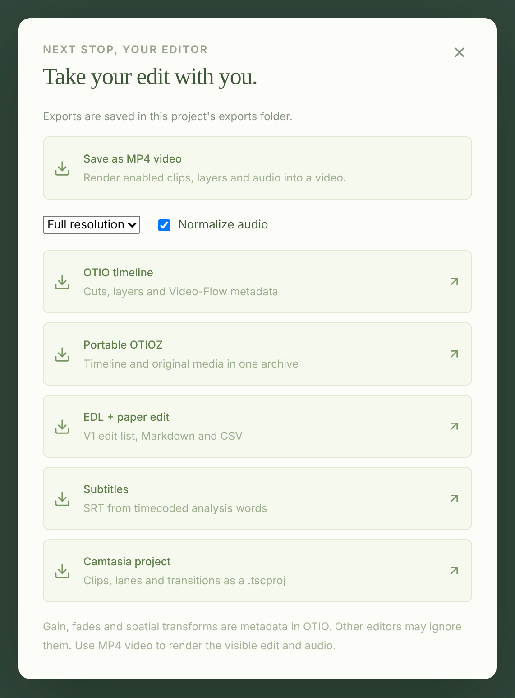
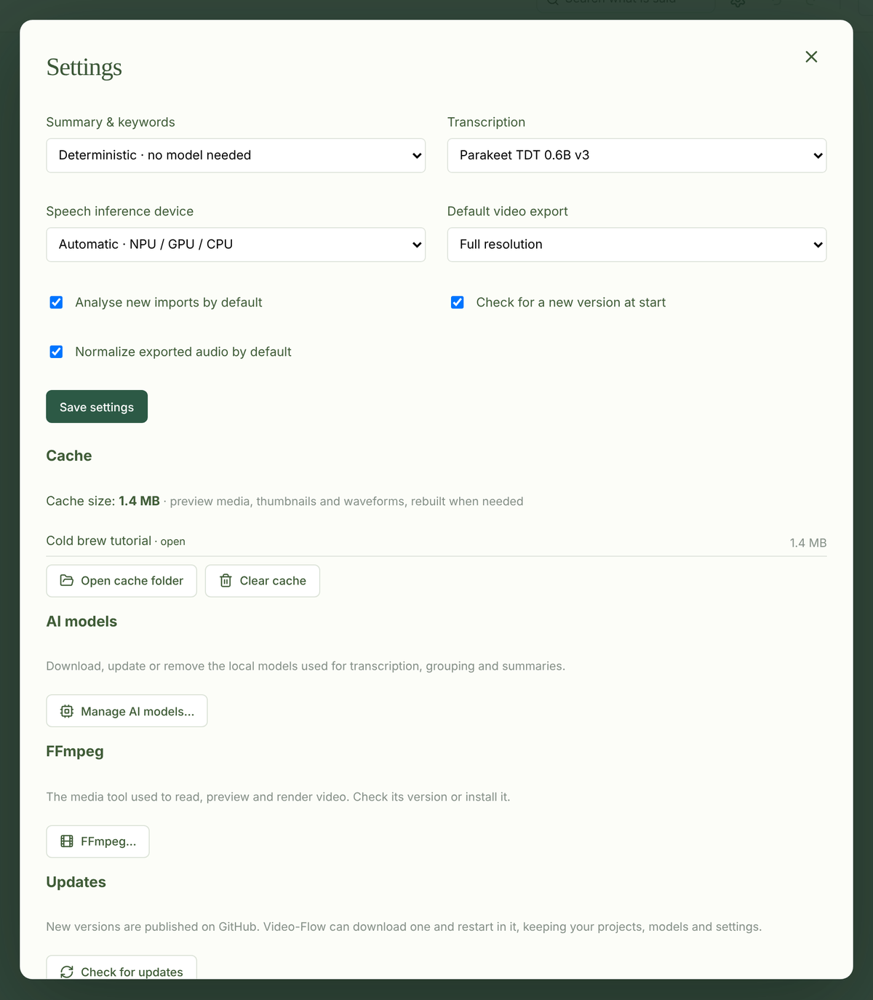

# Video-Flow

A desktop video editor for footage recorded with many retakes: tutorials, talks, interviews, course videos. Video-Flow transcribes your rushes on your computer, stacks the retakes of the same sentences on top of each other so you can compare them and keep the best one, then lets you cut, finish and render the edit, or hand it over to another editor.

Windows 11 x64 and Linux x64. The editor, the analysis, the MP4 render and the exports work end to end; tuning on real rushes and hardware qualification are in progress ([roadmap](docs/roadmap.md)). Everything runs locally: no account, no upload, your original files are never copied or modified.

## The idea

When you record a tutorial, you say each sentence two, three, five times until it sounds right. Sorting those takes by hand is most of the editing time. Video-Flow does that sorting:

1. **Import** the folder of rushes. Each file is transcribed (words with their times), summarised and split into topics.
2. **Stack**: a file that says the same sentences as an earlier one is placed over it, on a new lane, at the same position. Retakes end up grouped by what is said, not by file name.
3. **Compare** the stacked takes side by side, synchronised on their first common word, with the words that differ highlighted. Press 1, 2, 3… to keep one.
4. **Cut and finish**: trim to the spoken words, remove silences, add transitions, fades, titles, keyframed moves.
5. **Output**: render an MP4, or export the edit to Camtasia, OpenTimelineIO, EDL, subtitles or a paper edit.

## Features

**Import and analysis**
- Video, audio and pictures (PNG, JPEG, WebP, BMP, TIFF); files are referenced where they are, in the project folder next to them.
- Local transcription (Parakeet TDT 0.6B v3 or Whisper), summary, keywords and titled topics per file. The analysis is saved as a JSON file next to the media and reused on the next import.
- Retakes stacked automatically by sentence similarity (multilingual MiniLM embeddings plus word overlap).
- Preview media made in the background: a clip is usable within seconds of its import (one picture per second with its sound), and the smooth preview video replaces it when ready, one file at a time at low priority.

**Editing**
- Clip flow and timeline with lanes, linked video and audio, split, delete, ripple delete, trim handles, undo and redo.
- Transcript tab: click a word to set the range, then trim the clip to it or cut it out. Auto-trim silence keeps only the spoken part.
- Text search (Ctrl + F): find where a word is said in the edit; occurrences are marked in the clips and Enter jumps from one to the next.
- Compare takes, pick with 1–9.
- Freeze frames, still images of any length.

**Finishing**
- Transitions on the cuts: cross dissolve, dip to black, dip to white.
- Effects per clip: fade in and out, speed (25–400 %, audio pitch kept), muted ranges, music ducked under speech.
- Keyframed position, size, rotation, crop and opacity.
- Titles and lower thirds.

**Output**
- MP4 render with FFmpeg, full resolution or draft, optional loudness normalisation; hardware encoders when available.
- Camtasia project (2023.4 and later), OpenTimelineIO (OTIO, OTIOZ with the media), CMX 3600 EDL, SRT subtitles, paper edit (Markdown and CSV).

What each feature does, step by step, is in the [user manual](docs/features/README.md).

## Install

1. Download the ZIP for your system from the [latest release](https://github.com/VincentGuigui/video-flow/releases/latest): `Video-Flow-<version>-windows-x64.zip` (about 580 MB) or `Video-Flow-<version>-linux-x64.zip` (about 1 GB). Its `.sha256` file lets you check the download.
2. Extract the **whole** ZIP to a folder you can write to, for example `C:\Apps\Video-Flow` or `~/Apps/Video-Flow`. Keep the `_internal` folder next to the executable.
3. Start `Video-Flow.exe` (Windows) or `./Video-Flow` (Linux). To get a menu entry, run `Add Video-Flow to Start Menu.bat` or `add-video-flow-to-menu.sh` from the same folder.

On Linux the app uses the usual desktop libraries (OpenGL/EGL, xkbcommon, fontconfig, NSS, ALSA); on Debian or Ubuntu, if the window does not open: `sudo apt install libegl1 libgl1 libxkbcommon0 libxkbcommon-x11-0 libfontconfig1 libnss3 libasound2`.

### First start

Three windows may open, one after the other. Nothing is downloaded without your click.

| Window | When | What it does |
|--------|------|--------------|
| **Update** | A newer release exists on GitHub | Downloads it, checks it and restarts in it, keeping your models and settings ([updates](docs/features/getting-started/updates.md)) |
| **FFmpeg** | No FFmpeg 6.1 or newer is found | Downloads a pinned FFmpeg build (about 180 MB on Windows, 40 MB on Linux) into `tools/ffmpeg/`, checked against its SHA-256 ([FFmpeg setup](docs/features/getting-started/ffmpeg-setup.md)) |
| **AI models** | A model needed for analysis is missing | Downloads the models from Hugging Face into `models/`: about 770 MB for the default set (speech detection, Parakeet transcription, sentence similarity) ([AI models](docs/features/getting-started/ai-models.md)) |

Then create a project: give it a name and pick the folder of your rushes. The project is a `<name>.video-flow` folder inside it; the media are referenced by relative paths, so the whole folder can be moved or copied ([projects](docs/features/getting-started/projects.md)).

Everything the app downloads stays in its own folder (`models/`, `tools/`, `cache/`, `settings.json`). Deleting the folder removes it all.

## NPU, then GPU, then CPU

Transcription, speech detection and sentence similarity run as ONNX models. For each model, Video-Flow tries the processors of your computer in this order and keeps the first one that works:

1. **NPU** (neural processor): Intel through OpenVINO, AMD through Vitis AI, Qualcomm through QNN.
2. **GPU**: NVIDIA through CUDA, any DirectX 12 GPU on Windows through DirectML, Intel through OpenVINO, AMD through ROCm.
3. **CPU**: always available.

"Works" means the model loads on that processor **and** runs a first inference: drivers that are present but broken, or operators a processor does not support, send that model to the next one instead of failing. Each model is placed on its own, so a model the NPU cannot run does not move the others off it. Settings → **Speech inference device** forces CPU, or makes the GPU or the NPU the first choice.

The released builds include DirectML (Windows) and the CPU runtime (Linux); the other providers come with a source install for that hardware ([development](docs/reference/development.md)). The MP4 render follows the same idea for video encoding: it uses a hardware encoder when one is found and retries with the software encoder if that fails.

## Technology

| Part | Built with |
|------|------------|
| Desktop window | PySide6 / Qt WebEngine |
| Editor interface | React, Vite, Zustand, TypeScript |
| Local service | Python 3.13, FastAPI, uv |
| Media | FFmpeg 6.1+ (probe, previews, render), Pillow (titles, with the Inter font) |
| AI | ONNX Runtime (Silero VAD, Parakeet TDT, MiniLM), optional faster-whisper and Qwen 2.5 0.5B via PyTorch |
| Interchange | OpenTimelineIO, CMX 3600 EDL, Camtasia `.tscproj` |

Every dependency with its version and licence: [dependencies](docs/reference/dependencies.md). How the parts fit together: [architecture overview](docs/architecture/overview.md).

## Documentation

- [User manual](docs/features/README.md): every feature, stage by stage
- [Development](docs/reference/development.md): install from source, run, test, package
- [Command line](docs/reference/command-line.md): open projects and export without the window
- [Roadmap](docs/roadmap.md) and [release notes](docs/release_notes.md)
- [Documentation index](docs/README.md): specification, architecture, decisions, references
- [AGENTS.md](AGENTS.md): conventions for contributors and coding agents

The demo project in the screenshots is made of synthetic slides with a synthetic voice; its transcripts, summaries and stacking come from the real analysis.
