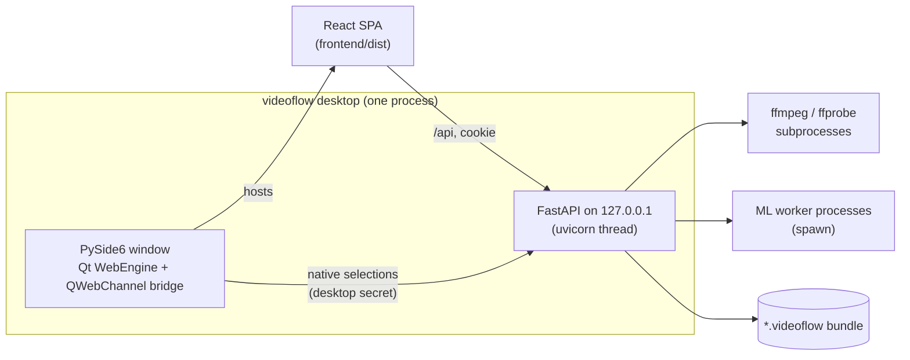

# Architecture

Video-Flow is a local-first desktop editor for footage shot with many retakes. A Python backend does media, analysis, render and export work; a React interface edits one project at a time. Everything runs on the user's machine: originals are referenced in place and never copied or modified, and the only network access is an explicit model download from Settings.

Related documents: [desktop shell](desktop-shell.md), [data model](data-model.md), [analysis pipeline](analysis-pipeline.md), [render and export](render-export.md). Behaviour is described per feature in [`../features/`](../README.md#features).

## 1. Process model

- **Desktop host** (`desktop/host.py`, `videoflow desktop`): picks a free loopback port, starts uvicorn in a thread, opens a `QMainWindow` with a `QWebEngineView` on `http://127.0.0.1:<port>/?token=…`. Navigation and requests are restricted to that origin. A `QWebChannel` bridge exposes only native file dialogs, OS file drops, relink, interface zoom and "save rendered video". Closing the window shuts down the server, which cancels imports, renders and downloads and stops their child processes. Details: [desktop shell](desktop-shell.md).
- **Browser mode** (`videoflow serve`): the same API and SPA for diagnostics; the launch URL is printed and opened in the browser. Imports go through `POST /api/import-path`, limited to `--media-root` folders (default: the bundle's parent).
- **Authentication** (`api/app.py` middleware): requests must carry the exact `Host` (and `Origin`, when present) of the loopback server. `/?token=` is exchanged once for an `HttpOnly`, `SameSite=Strict` cookie `videoflow`; every other request needs that cookie. Native-only endpoints also require the `x-videoflow-desktop` secret that only the Qt host holds.
- **Trusted sources**: a native selection is turned into single-use handles (`desktop/grants.py`); the SPA imports or relinks only through a handle. `PATCH /api/project` accepts `SetEditor`, `SetSettings`, `RenameProject`, `RemoveAsset`, `Batch`, and `AddAsset` / `RelinkAsset` only for sources the server already trusts, so the interface cannot introduce arbitrary file paths. Byte uploads are disabled.
- **One project per process**: the API holds one open bundle; the project library (`project/library.py`) creates, opens, renames and deletes bundles next to it and switches the open one when no import or render is running. The default desktop project is `Video-Flow/Untitled.videoflow` under `%LOCALAPPDATA%` (Windows) or `~/.local/share` (Linux).
- **Packaging**: `scripts/desktop.spec` (PyInstaller) with `desktop_entry.py` builds a standalone folder that bundles the built SPA; Node, uv and Vite are not needed at runtime. Application files (`settings.json`, `models/`, `templates/`) live beside the executable (`runtime.py`).

## 2. Repository layout

| Path | Content |
|------|---------|
| `backend/` | `videoflow` package (uv project, `pyproject.toml`, `uv.lock`) and `tests/` |
| `frontend/` | Vite + React app: `src/*.ts` pure logic with vitest tests, `src/ui/*.tsx` components; built into `frontend/dist` |
| `scripts/` | `install`, `run`, `dev` (`.sh` and `.ps1`), `gen_samples.py`, `desktop.spec`, `desktop_smoke.py` |
| `docs/` | Product, features, architecture, decisions, reference, validation |
| `tools/` | Git-ignored; the installer's static FFmpeg in `tools/ffmpeg/`, looked up before `PATH` |

## 3. Backend modules (`backend/videoflow/`)

| Module | Responsibility |
|--------|----------------|
| `api/` | `app.py`: FastAPI app factory, authentication middleware, every endpoint, SPA static files |
| `core/` | Shared base model (camelCase JSON, unknown fields kept, open enums), `<prefix>_<ULID>` ids, integer-microsecond time and rational frame rates |
| `project/` | Project schema (`models.py`), semantic commands with inverses (`commands.py`), bundle store with atomic save, `history.jsonl` and revisions (`store.py`), migrations, JSON Schema goldens (`schema.py`), project library |
| `editor/` | The interactive edit document (`models.py`), import queue (`imports.py`), analysis sidecars and the transcriber worker (`analysis.py`), retake grouping, topics and summaries, transitions, volume, zoom, titles (Pillow + bundled Inter), playback WebM fallback, resolution of the document for render and export (`resolve.py`) |
| `timeline/` | Resolved timeline contract (flat, frame-quantised tracks), resolver, transition handle maths, invariant checks; shared by exporters and render |
| `media/` | FFmpeg capability probe and binary lookup (`caps.py`), async FFmpeg runner with progress and cancellation plus ffprobe parsing, content hashing, ingest (probe, hash, duplicate detection), proxies, thumbnail sprites, waveform peaks |
| `analysis/` | Analysis library: text normalisation, segmentation, relations, clustering, intra-group alignment, scoring, ordering, reconciliation, GCC-PHAT audio sync, shot detection, content-hash stage cache. See [analysis pipeline](analysis-pipeline.md) |
| `engines/` | Engine protocols and deterministic fakes, registry (`registry.py`), adapters (`asr/`, `vad/`, `embed/`, `vision/`), Qwen summaries, pinned model manifest and explicit downloads |
| `hw/` | AI provider chain and ONNX session factory (`ai.py`), hardware video decode/encode probing (`video.py`), doctor report |
| `jobs/` | Long-lived spawned ML worker processes (`workers.py`) |
| `render/` | Filter graph compiler (`graph.py`), cancellable runner with output validation, two-pass loudness, render job owner (`jobs.py`) |
| `exporters/` | OTIO, OTIOZ, CMX 3600 EDL, SRT, paper edit (Markdown + CSV), Camtasia `.tscproj`; `service.py` writes them with `edit.report.json` |
| `desktop/` | Qt host and bridge, selection grants, native smoke check |
| `preferences.py` | Application preferences (ASR engine, summary engine, AI device, import and render defaults) in `settings.json` |
| `runtime.py` | Application directory (beside the executable or the repository root), opening folders |
| `samples.py` | Deterministic synthetic rushes (lavfi + flite TTS) with a ground-truth manifest |
| `cli.py` | Typer CLI `videoflow`: `desktop` (default via `scripts/run`), `serve`, `export`, `version`, hidden `desktop-check` |

## 4. Frontend (`frontend/src/`)

React 19, Vite and Zustand; no other state or UI framework (icons from `lucide-react`).

- **Pure logic** (`*.ts`, each with a `*.test.ts`): `model.ts` (edit document types, layout, lanes, linking; mirrors `editor/models.py`), `transitions.ts`, `volume.ts`, `zoom.ts` and `titles.ts` (mirrors of the backend modules of the same name, kept in step), `range.ts`, `snap.ts`, `compare.ts`, `transcript.ts`, `zones.ts`, `timeline.ts`, `playback.ts`, `desktop.ts` (Qt bridge and media URLs).
- **UI** (`ui/`): `App.tsx` (editor shell), `Home.tsx` (project library), `Flow.tsx` (clip flow), `Preview.tsx`, `Transport.tsx`, `Transcript.tsx`, `Compare.tsx`, `Imports.tsx`, `RenderPanel.tsx`, `Settings.tsx`, `ProjectSave.tsx` and property controls.
- **State** (`store.ts`): one Zustand store holds the project, the edit document, selection, zone, focus, cursor frame, range and the undo/redo stacks.
- **Saving**: every edit sends the whole document as `{baseRevision, commands: [SetEditor, ...]}` through `PATCH /api/project`. The backend applies the batch atomically, bumps the revision and returns the project, the resolved editor document and the inverse commands. A stale `baseRevision` is rejected with 409 and the store reloads.
- **Undo/redo**: the client owns the stacks (last 100 steps). Undo sends the stored inverses as a new batch and pushes the returned inverses on the redo stack. Imports return their inverses too, so an import is one undo step.
- **Preview**: each visible clip plays its proxy in its own `<video>` element, positioned with the clip transform, crop, opacity and zoom; audio gain (fades, mutes, ducking) is applied through the media element volume. H.264 proxies are used when the engine can play them, else a VP9 WebM (`/api/media/{id}?codec=webm`). Titles are the PNG the render uses (`/api/title`). The FFmpeg render is the reference.
- **Progress**: the UI polls `/api/jobs`, `/api/renders` and `/api/settings`.

## 5. API

All under `/api`, JSON in camelCase.

| Method | Path | Purpose |
|--------|------|---------|
| GET / PATCH | `/project` | Open project, resolved editor document, media roots, offline assets / apply a command batch |
| POST | `/project/save` | Save, name, or Save as (copy) |
| GET / POST | `/projects`, `/projects/action` | Project library / new, open, rename, delete |
| GET / PUT | `/settings` | Preferences, cache folder, model states / update preferences (refused while imports run) |
| POST | `/open-cache` | Open the project cache folder |
| POST | `/models/{key}/download`, `/models/{key}/cancel` | Explicit model download / cancel |
| POST | `/desktop/selection` | Host only: issue single-use handles for natively selected files |
| POST | `/native-import`, `/native-relink` | Import or relink (content hash checked) through a handle |
| POST | `/import-path` | Browser mode: import a file under a media root |
| POST | `/uploads/{batch}/{file}` | Byte upload; disabled in the shipped app |
| GET / POST | `/jobs`, `/jobs/cancel` | Import jobs / cancel one or all |
| GET | `/media/{asset}` | Proxy (or source audio), with byte ranges; `?codec=webm` fallback |
| GET | `/analysis/{asset}` | Transcript words, summary, keywords, topics |
| GET | `/waveform/{asset}`, `/thumbnail/{asset}` | Peaks (RMS, downsampled) / one 240 px JPEG frame |
| GET | `/title?spec=` | Title picture at project size |
| POST | `/export` | Export formats into `exports/` |
| POST / GET | `/render`, `/renders` | Start an MP4 render (`draft`/`final`, loudness normalisation) / list renders |
| POST / GET | `/renders/{id}/cancel`, `/renders/{id}/file` | Cancel / download |
| POST | `/desktop/render-save` | Host only: copy a finished render to the path chosen in the native save dialog |

## 6. Jobs, imports, renders and downloads

- **Imports** (`editor/imports.py`): one asyncio task per file, run one at a time. Steps: probe and hash (duplicates reuse the existing asset), build the proxy, load analysis (sidecar beside the source, then the bundle cache), otherwise wait for missing models (`waiting-models`), extract 16 kHz mono PCM, transcribe in the worker, derive summary, keywords and topics, store the analysis, match retakes, then publish `AddAsset` + `SetEditor` as one commit. Progress, phase, warnings and inverses are on the job. See [interactive editor](../features/interactive-editor.md), [retake grouping](../features/retake-grouping.md).
- **ML workers** (`jobs/workers.py`): engines run in long-lived processes started with `spawn`; a worker builds its engine once and serves calls over a pipe. Cancelling a call kills the process and respawns it, since ONNX and CTranslate2 calls cannot be interrupted.
- **Renders** (`render/jobs.py`): one render at a time from an immutable project snapshot; cancellable; the MP4 is published to `renders/` only after frame and duration checks.
- **Downloads** (`engines/downloads.py`): one cancellable download per model, in a worker process, from the pinned Hugging Face revision into `models/`. Inference never triggers a download.
- Jobs are in memory only. After a restart the user re-imports; cached proxies and analysis make that fast.

## 7. Media handling

- **FFmpeg** >= 6.1 (installer check), run as subprocesses with `-progress` parsing; `media/caps.py` probes version, filters, encoders, hardware accelerations and the filter-graph file flag.
- **Content hash** (`media/hashing.py`): BLAKE2b of the whole file up to 64 MiB, else of its size plus 16 evenly spaced chunks. It keys duplicates, caches and sidecars, and checks relinks.
- **Proxies** (`media/proxy.py`): H.264 8-bit SDR BT.709, short side at most 540 px, CFR, a keyframe every second, rotation baked in, HDR tone-mapped when `zscale` and `tonemap` exist; proxy time equals source time. Hardware decode/encode from `hw/video.py`, with a software retry.
- **Thumbnails**: one 240 px JPEG per video asset, from the proxy, on first request. **Waveforms**: one-resolution peaks file (`VFPK`: min, max, RMS per bucket) on first request.
- Proxies, thumbnails, peaks, title pictures, WebM fallbacks and render scratch files are in the bundle `cache/`; sentence vectors in `features/`. See [workspace zones](../features/workspace-zones.md) for the cache folder.

## 8. AI engines and device selection

| Purpose | Default | Alternatives | Runtime |
|---------|---------|--------------|---------|
| VAD | Silero VAD | — | ONNX Runtime |
| ASR | Parakeet TDT 0.6B v3 int8 (`onnx-asr`) | faster-whisper tiny (`whisper` extra, CPU/CUDA) | ONNX Runtime / CTranslate2 |
| Retake grouping | paraphrase-multilingual-MiniLM-L12-v2 | word overlap only, without the model | ONNX Runtime |
| Summary and topic titles | Deterministic (extractive, TextTiling-style) | Qwen2.5-0.5B-Instruct (`qwen` extra) | Python / PyTorch on CPU |
| Visual similarity | DINOv2-small, perceptual hash | — | ONNX Runtime; library and tests only |
| Shots | PySceneDetect | — | OpenCV; library and tests only |

- Models are pinned to immutable revisions with licence and gating checks in `engines/manifest.toml`, and stored in the application `models/` folder (`VIDEOFLOW_MODELS_DIR`).
- `engines/registry.py` maps `(kind, name)` to adapters with lazy imports; a missing extra raises `EngineUnavailableError` naming what to install. Fakes replay fixtures for tests.
- `hw/ai.py` orders the available ONNX Runtime providers **NPU → GPU → CPU**: OpenVINO NPU, VitisAI, QNN; then CUDA, DirectML, OpenVINO GPU, ROCm, MIGraphX; then CPU. The `aiDevice` preference (`auto`, `npu`, `gpu`, `cpu`) chooses the first tier. Each model walks the chain on its own and keeps the first provider that creates a session, is actually active and passes a warm-up run.
- Accelerator extras (`cpu`/`smoke`, `openvino`, `directml`, `cuda`, `qnn`) are mutually exclusive onnxruntime flavours on top of `ml`; the installer picks one from the detected hardware. See [dependencies](../reference/dependencies.md).

## 9. Project bundle

A `*.videoflow` folder: `project.json` (schema-versioned decisions, including the editor document), `history.jsonl` (write-ahead command log, replayed on load), `project.v<N>.bak.json` after a migration, `analysis/` (analysis sidecar cache), `features/`, `cache/`, `exports/`, `renders/`. Writes are atomic (temp file, fsync, rename). Details: [data model](data-model.md).

The edit document holds clips in integer project-rate frames: video, audio, empty and text clips on numbered lanes, linked video/audio pairs and transitions. Render compiles it into FFmpeg filter graphs; exporters read the same edit through the timeline resolver. See [render and export](render-export.md).

## 10. Testing

- **Unit tier** (`uv run pytest`, default): CPU only, no network, synthetic media generated by the tests, fake engines; tests needing the `ml` extra are skipped without it. Covers contracts and schema goldens, commands and store, time, analysis library, engines, grouping benchmark (`tests/fixtures/retake_pairs.json`), exporters, render graphs and output, API.
- **Smoke tier** (`uv run pytest -m smoke`): downloads small real models and runs them on CPU.
- **Frontend**: vitest on the pure logic modules, `tsc` type check, Prettier.
- **Desktop**: `scripts/desktop_smoke.py` (`videoflow desktop-check`) drives the real Qt window on generated media and writes a screenshot and report.
- Lint and types: Ruff and strict mypy. Commands are listed in `AGENTS.md`.

## 11. Not implemented

- FCPXML, FCP7 XML and AAF export; OTIO re-import.
- Multicam sync groups, comping, script-guided grouping; the clustering and scoring pipeline in `analysis/` is not wired into the editor import.
- Extended transitions (wipes, slides), subtitle burn-in.
- Cloud or remote LLM providers.

See the [roadmap](../roadmap.md) for what comes next.
