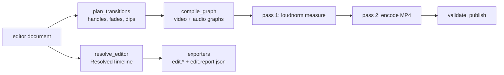

# Render and export

Video-Flow produces two kinds of output from the editor document ([data model](data-model.md)): an **MP4 render** compiled to FFmpeg filter graphs, and **file exports** (OTIO, OTIOZ, EDL, SRT, paper edit, Camtasia) written from a resolved timeline. Both read the original media in place; nothing is copied except into an OTIOZ archive. See the [overview](overview.md) for where these modules sit.



## 1. Render graph

`render/graph.py` `compile_graph(project, preset, titles_dir)` turns the document into one video graph and one independent audio graph (input indices are local to each). `render_document` takes the editor document, or converts a legacy authored edit when it has no transitions or fades (otherwise it refuses), then checks every clip against its asset. Disabled clips are left out and uncovered time is closed up (`layout` in `editor/models.py`); empty clips and retained audio time ([unified timeline](../features/editing/unified-timeline.md)) keep their span as black and silence.

### Video

- **Base:** a black RGBA `color` source at the output size and project rate, trimmed to the total frame count. Every layer is overlaid on it, so the base drives timing.
- **Clip order:** clips are composited bottom-up by lane, then by start.
- **Per video clip** (one input per clip, read with `-threads 1`):
  1. `fps=<project rate>:round=near`, then `trim` to the source in/out frames.
  2. Retime: `setpts=PTS-STARTPTS`, or at another speed `setpts=(PTS-STARTPTS)/speed` and `fps` again ([clip effects](../features/finishing/clip-effects.md)).
  3. `tpad=stop_mode=clone` and `trim` to the exact clip length (guards against a short last frame).
  4. HDR (HLG or PQ probe): `zscale` to linear, `tonemap=hable`, back to BT.709 SDR; a warning names the clip.
  5. `setsar=1,format=rgba`, then alpha `fade` in/out for dissolves and edge fades.
  6. Background (from [editor refinements](../features/editing/editor-refinements.md)): `color` (a colour plate with the same alpha fades), `blur` (the same frames `split`, scaled to cover the frame with 8 % overscan, cropped, `gblur`), or `transparent` (none).
  7. Picture: `scale` to the transform size, `crop` for the crop insets, then `overlay` at the transform position. A clip with keyframes, a rotation or an opacity below 1 is drawn per frame instead: crop (`crop`, or `perspective` when it animates), a transparent border, `perspective` onto the rotated box corners (piecewise expressions from `editor/keyframes.py`), `colorchannelmixer` for opacity, then `overlay` of the full frame ([keyframed transforms](../features/finishing/keyframes.md)).
- **Placement:** each layer is shifted with `setpts=PTS+start/rate` and overlaid with `eof_action=pass:repeatlast=0` and an `enable` window on **timestamps** with half-frame margins (`gte(t,…)*lt(t,…)`), never frame counters.
- **Text clips:** the title picture (Pillow, bundled Inter; `editor/titles.py`) is an image input `loop`ed for the clip's frames, alpha-faded and overlaid in its window. Pictures are keyed by a hash of the title and output size and drawn by `write_titles` into `cache/titles/` before FFmpeg runs, so no `drawtext` is needed.
- **Dips:** after all lanes, each dip is a full-frame black or white `color` layer that fades in over `before` frames and out over `after` frames, overlaid on the composite.
- **Output:** `trim` to the total, `settb`/`setpts=N` to a constant rate, `format=yuv420p` → `[vout]`.

### Audio

- **Base:** `anullsrc` stereo at the project sample rate, trimmed to the exact sample count.
- **Per audio clip:** `aresample`, `aformat` fltp stereo, `atrim` on source samples, `atempo` chain (factors kept within 0.5–2) at another speed, `volume` envelope for mute and duck ranges (per-frame expression from `editor/volume.py`, over the clip's timeline seconds), `apad`/`atrim` to the clip's sample count, `afade` in/out (transition crossfades, dips and edge fades), clip gain `volume=<dB>`, `adelay` to its start.
- **Mix:** `amix` with `normalize=0`, `duration=first` (the silent base), then `atrim` → `[aout]`. A disabled audio clip is absent, so its span is silent.

### Transitions

`editor/transitions.py` plans the active transitions ([transitions](../features/finishing/transitions.md)): a transition is active only between adjacent enabled video clips on one lane. The requested duration `T` is split `before = ⌊T/2⌋`, `after = T − before`, centred on the cut, and the total length never changes.

| Type | Plan | Render |
|------|------|--------|
| `dissolve` | Left clip extended `after` frames into its source handle, right clip starts `before` frames early | Alpha fade-in of the right clip (and its backdrop) over the left; linked audio crossfades with `afade` |
| `dip_black`, `dip_white` | No handles | Colour layer over the whole picture; left audio fades out over `before`, right fades in over `after` |

Missing source handles (divided by speed) or clips shorter than a half shorten the transition, with a warning in the render log. Edge fades merge with transition fades; the longer wins on an edge.

### Presets

| Preset | Output size | Software video | Hardware video | Audio |
|--------|-------------|----------------|----------------|-------|
| `final` | Project size | libx264 `-crf 18 -preset medium -threads 2` | quality value 18 | AAC 192 kb/s |
| `draft` | Long side ≤ 960 px (even dimensions, transforms scaled on both axes) | libx264 `-crf 28 -preset ultrafast -threads 2` | quality value 28 | AAC 128 kb/s |

Both presets write H.264 MP4 at the project rate (`-fps_mode cfr`), project sample rate, stereo, BT.709 colour tags, `+faststart`, no source metadata (`-map_metadata -1`). Project width and height must be even.

## 2. Render runner

`render/runner.py` `render_project` runs one render on an immutable project snapshot.

1. **Capabilities** (`media/caps.py`): FFmpeg is found in settings, then `tools/ffmpeg/`, then `PATH`. A graph that tone-maps HDR sources requires `zscale` and `tonemap`.
2. **Filter scripts:** graphs are written to `cache/render/<id>/*.ffgraph` and passed with `-/filter_complex` when the build accepts it, else `-filter_complex_script` (Windows command lines are length-limited). Both use `-filter_complex_threads 1`.
3. **Loudness** (`render/loudness.py`, when normalisation is on and there is audio): pass 1 renders the audio graph alone through `loudnorm=I=<target>:TP=<peak>:LRA=11:print_format=json` to a null output; pass 2 appends the measured values with `linear=true`. Targets come from the project settings (default −14 LUFS, −1 dBTP). Silent or below-gate audio skips normalisation with a warning.
4. **Encoder** (`hw/video.py`): unless the CPU is forced, the first H.264 encoder that FFmpeg lists **and** that passes a one-frame test encode (probe cached per FFmpeg binary) is used, in the order below; otherwise libx264.

   | Encoder | Platform | Quality option |
   |---------|----------|----------------|
   | `h264_nvenc` (`-preset p4`) | Windows, Linux | `-cq` |
   | `h264_qsv` | Windows, Linux | `-global_quality` |
   | `h264_amf` | Windows | `-qp_i` |
   | `h264_mf` (Media Foundation) | Windows | `-q` |
   | `h264_vaapi` (first render node, `format=nv12,hwupload` appended to the graph) | Linux | `-qp` |
   | `libx264` (fallback) | all | `-crf` |

   If a hardware encode fails, the render is retried once with libx264 and a warning is logged. Decoding is always in software.
5. **Progress and cancellation:** `-progress pipe:1` is parsed against the expected duration and mapped to phases (measure 2–20 %, encode 20–94 %, validate). Jobs (`render/jobs.py`) run one at a time; the editor polls `GET /api/renders`. Cancel sends `q` on stdin, then terminates, then kills FFmpeg.
6. **Validation:** ffprobe must report exactly the planned frame count, size and rate, an audio stream at the project sample rate, and an audio duration within one frame of the video.
7. **Publication:** the encode writes `renders/.render-<id>.part.mp4`; only a validated file is renamed to `renders/render-<id>.mp4`. The partial file is always removed. `renders/render-<id>.log.json` records project id and revision, preset, size, rate, expected and actual frames and samples, FFmpeg version, every attempt (phase, arguments, return code, stderr tail), loudness measurement, encoder, warnings, state (`done`, `failed`, `cancelled`) and elapsed time.

API: `POST /api/render` (`baseRevision`, `preset`, `normalize`; refused if the project changed or a render is running), `POST /api/renders/{id}/cancel`, `GET /api/renders/{id}/file`. The desktop shell copies the finished file to a path chosen in a native save dialog (`POST /api/desktop/render-save`, never over an original).

## 3. Exports

`exporters/service.py` `export_project` validates the formats, resolves the edit once, writes every file atomically under fixed names and adds `edit.report.json` (project id, revision, rate, duration, formats, files, warnings). Existing files are refused unless `overwrite` is set (the editor always overwrites). The editor export menu writes into the bundle's `exports/` folder and loads transcripts from the analysis sidecars.

For an editor document, `editor/resolve.py` `resolve_editor` builds the `ResolvedTimeline`: one track per lane (`V1`, `V2`, … bottom-up for video and text; `A1`, … for audio), active transitions on the bottom video lane only, text clips as gaps carrying their title.

| Format | Files | Content |
|--------|-------|---------|
| `otio` | `edit.otio` | Every lane as a track (overlapping clips split onto extra tracks), gaps, markers; dissolve as `SMPTE_Dissolve`, dips as `Custom`, with in/out offsets; `videoflow` metadata on the timeline and every clip (transform, layer, speed, title, gain). `--include-alternates` adds a disabled `ALT` track per disabled video clip (unpicked take) at its position, or per unused take of legacy beats |
| `otioz` | `edit.otioz` | The same timeline zipped with each original once under `media/` (fails before publication if a file is missing) |
| `edl` | `edit.edl`, `edit.reels.json` | CMX 3600, V1 only, non-drop timecode, reels `R0000001`… mapped to paths in JSON and comments; dissolves and dips as `D` events; ≤ 999 events |
| `srt` | `edit.srt` | Words of `A1` mapped from source to timeline, fillers removed, cues ≤ 2 × 42 characters, ≤ 6 s, split on sentence ends, pauses > 0.6 s and clip changes, ≥ 1 s where room allows, no overlap |
| `paper-edit` | `edit.md`, `edit.csv` | One row per `V1` clip: order, beat, asset path, source in/out, duration, transcript |
| `camtasia` | `edit.tscproj` | Template-driven Camtasia 2023.4+ project, see below |

`exporters/transcript.py` is the shared word mapper for SRT and the paper edit (authored transcript corrections applied); it is not a separate format.

### What each export drops

Resolver warnings are copied into `edit.report.json` and printed by the CLI:

| Warning | Meaning |
|---------|---------|
| `editor_transition_layer` | Transitions above the bottom lane are rendered, not exported |
| `editor_transition_audio` | Audio crossfades of transitions are rendered, not exported |
| `editor_speed` | Speed is rendered; OTIO and EDL carry it as metadata only |
| `editor_titles` | Titles go to the render and Camtasia; OTIO and EDL see gaps (OTIO keeps the text as metadata) |
| `editor_transforms` | Spatial transforms are OTIO metadata |

The service adds that OTIO gain, fades and fit are metadata only; the EDL adds that audio, overlays, gain and fades are omitted, and that dips become dissolves. Keyframes (OTIO metadata only), mute and duck ranges, backgrounds and crop are not carried by OTIO or EDL; SRT and the paper edit drop words said inside a mute range (resolved audio clips carry them as `muted` source ranges) and read an editor video clip's words from its linked audio clip (`linkId`). SRT and paper edit map words through the clip speed.

### Camtasia

`exporters/camtasia.py` writes `.tscproj` 7.0 by cloning structures from a template (`templates/camtasia.tscproj` in the application folder, `--camtasia-template`, or the built-in 2023.4.3 default). It maps lanes to tracks, linked pairs to `UnifiedMedia`, times to 705 600 000 ticks per second, transforms, gain, speed, transform and volume keyframes, edge fades, dissolves and dips as `Fade`/`FadeThroughBlack`, and titles as text callouts. Crop, backgrounds, transition audio crossfades, gaps and disabled clips are reported as not exported. Details: [Camtasia export](../features/output/camtasia-export.md), [clip effects](../features/finishing/clip-effects.md).

### CLI

```bash
videoflow export BUNDLE [--output DIR] [--otio] [--otioz] [--edl] [--srt] [--paper-edit] \
  [--camtasia [--camtasia-template PATH]] [--transcripts FILE.json] [--include-alternates] [--overwrite]
```

OTIO is the default when no format is given; `--srt` requires `--transcripts` (asset id → transcript with source-microsecond word times). The command prints each written path, then the report warnings on stderr. Rendering has no CLI command.

## 4. Not implemented

See the [roadmap](../roadmap.md):

- FCPXML, FCP7 XML and AAF export; OTIO re-import.
- Transitions other than cross dissolve and dips (wipes, slides, iris, `xfade` catalog) and subtitle burn-in.
- Chunked or cached renders, mezzanine masters (ProRes, DNxHR), HEVC or 4K presets, vertical presets.
- Post-render loudness (`ebur128`) and black-frame checks.
- Camtasia media pack and macOS `.cmproj`.
