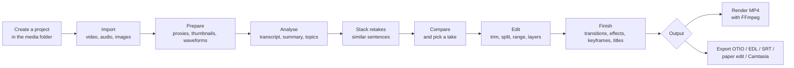

# Video-Flow user manual

Video-Flow turns a folder of rushes shot with many retakes into an edit. You import the media where they are, Video-Flow transcribes and analyses them locally, and stacks the retakes of the same sentences so you can compare them and keep the best. Then you cut, layer and finish the edit, and render an MP4 or hand the edit over to another editor.

This manual describes what the app does today, stage by stage. What it is meant to do is in the [functional specification](../product/functional-spec.md); how it is built is in [architecture](../architecture/overview.md).

## End-to-end workflow

Typical session: create a project in the folder of the day's rushes, drop 40 clips, let them be transcribed, compare the stacked retakes and pick one per sentence, trim the silences, add a dissolve and a title, render.

## 1. Getting started

| Page | What it covers |
|------|----------------|
| [Projects](getting-started/projects.md) | Projects as `<name>.video-flow` folders next to the media, the home page, recent projects, rename, delete |
| [FFmpeg setup](getting-started/ffmpeg-setup.md) | Where FFmpeg is found, and its download (with your consent) from the app or the install scripts |

AI models are downloaded on request from Settings → Manage AI models ([editor refinements](editing/editor-refinements.md)).

## 2. Import and analysis

| Page | What it covers |
|------|----------------|
| [Project media](import-analysis/media-library.md) | The media list, Info and Analyse again |
| [Still images and freeze frames](import-analysis/still-images.md) | Pictures as clips of any length, and freezing the frame at the cursor |
| [Transcript panel](import-analysis/transcript-panel.md) | Summary, topics and words of a clip; editing words; selecting a range from the text |
| [Retake grouping](import-analysis/retake-grouping.md) | How retakes of the same sentences are stacked on import |

## 3. Editing

| Page | What it covers |
|------|----------------|
| [Interactive editor](editing/interactive-editor.md) | The workspace: preview, timeline and clip flow, linked audio and video, trim modes, keyboard |
| [Unified timeline](editing/unified-timeline.md) | One cursor and ruler for timeline and flow, linking clips, audio trims |
| [Range and trim](editing/range-and-trim.md) | The timeline range, range playback, trim to range, auto-trim silence |
| [Compare takes](editing/compare-takes.md) | Stacked retakes side by side, picking one with 1–9 |
| [Audio tracks](editing/audio-tracks.md) | The audio of video clips: enable, detach, restore |
| [Workspace zones](editing/workspace-zones.md) | Select all and delete per zone, media removal, cache |
| [Properties panel](editing/properties-panel.md) | Resizing, height, pinned or floating panel |
| [Clip tooltip](editing/clip-tooltip.md) | The one-line description shown when hovering a clip |
| [Editor refinements](editing/editor-refinements.md) | Save and save as, backgrounds, MP4 export, AI models and components |

## 4. Finishing

| Page | What it covers |
|------|----------------|
| [Transitions](finishing/transitions.md) | Dissolves and dips on the cuts, from the Effects tab or the cut markers |
| [Clip effects](finishing/clip-effects.md) | Fades, speed, mute ranges, ducking under speech, titles and lower thirds |
| [Keyframed transforms](finishing/keyframes.md) | Animating position, size, rotation, crop and opacity |

## 5. Output

| Page | What it covers |
|------|----------------|
| [Camtasia export](output/camtasia-export.md) | The `.tscproj` export and what it carries |

The MP4 render and the other exports (OTIO, OTIOZ, EDL, SRT, paper edit) are opened with **Export**; see [editor refinements](editing/editor-refinements.md) and, for what each format carries, [render and export](../architecture/render-export.md).

## Writing this manual

Each page describes one feature as it works now, and sits in the folder of its stage. A new feature gets a page (or a section of the closest page) in the right folder and a row above. Technical details (code paths, data, validation) go at the end of the page.
