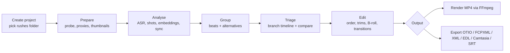
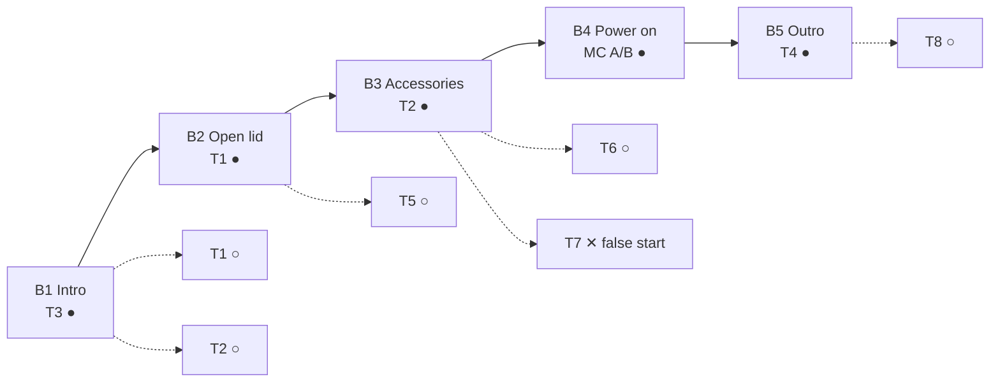

# 02. Functional specification

## 1. Scope

### Goals
- Turn a folder of rushes into a coherent edit with the least possible manual review.
- Make duplicate takes visible and comparable, and make choosing between them a one-click action.
- Produce a final video directly (FFmpeg) or a project that opens in a full editor.

### Non-goals (v1)
- Colour grading, keyframed effects, motion graphics, advanced audio mixing.
- Multi-user collaboration, cloud storage.
- Live recording or screen capture.

## 2. Glossary

| Term | Definition |
|------|------------|
| **Rush / Asset** | A source media file. Never modified. |
| **Segment** | A time range inside an asset produced by analysis: an utterance block (speech) or a shot (non-speech). The unit of grouping. |
| **Take** | A segment considered as one attempt at a beat. |
| **Beat** | A unit of the story ("open the lid", "show the charger"). Contains one or more alternative takes. |
| **Alternative / Branch** | One take of a beat. One is *selected*, others are *alternates* or *rejected*. |
| **Sync group** | Takes recorded simultaneously by different devices, time-aligned by audio (multicam). |
| **Main line / Cut** | The ordered sequence of selected takes, after trims and transitions. Compiled to OTIO. |
| **B-roll** | Footage placed on an upper video track over the main line, usually muted. |
| **Handle** | Extra source media before the in point or after the out point, needed by transitions. |
| **Word snapping** | Trim points snap to word boundaries from the transcript. |

## 3. End-to-end workflow



Typical session: drop 40 clips, wait for analysis, review 12 suggested beats with 2 to 5 takes each, fix 2 groupings by drag and drop, pick takes, add a crossfade at the start and end, render.

## 4. Functional requirements

Priority: **P0** = MVP, **P1** = shortly after MVP, **P2** = later.

### 4.1 Project and ingest (PRJ, ING)

| ID | Requirement | Prio |
|----|-------------|------|
| PRJ-01 | Create a project from a folder; the project is a bundle directory (see 05-data-model.md). | P0 |
| PRJ-02 | Autosave every change; unlimited undo/redo within a session. | P0 |
| PRJ-03 | Relink missing media by folder search on file name + size + content hash. | P1 |
| PRJ-04 | Project settings: output resolution, frame rate, sample rate, aspect ratio (16:9, 9:16, 1:1), target loudness. Defaults inferred from the majority of rushes. | P0 |
| ING-01 | Import video and audio files by folder or drag and drop (MP4, MOV, MKV, MTS, M4A, WAV). | P0 |
| ING-02 | Probe each asset: duration, codecs, resolution, rotation, frame rate (and VFR flag), colour transfer (HDR flag), audio streams, creation time. | P0 |
| ING-03 | Generate a proxy (720p H.264, short GOP), thumbnail sprites and waveform peaks for each asset. | P0 |
| ING-04 | Detect and skip exact duplicate files (same content hash). | P0 |
| ING-05 | Import an external audio recorder track and attach it to video assets through a sync group. | P1 |
| ING-06 | Add assets to an existing project and analyse only the new ones (incremental). | P1 |

### 4.2 Analysis (ANA)

| ID | Requirement | Prio |
|----|-------------|------|
| ANA-01 | Transcribe every asset with word-level timestamps; language auto-detected or forced in settings (default `fr`). | P0 |
| ANA-02 | Detect shots (scene changes) and silent ranges. | P0 |
| ANA-03 | Split assets into segments (utterance blocks and non-speech shots). | P0 |
| ANA-04 | Detect relations between segments: RETAKE, PARTIAL_RETAKE, VISUAL_DUPLICATE, SIMULTANEOUS (see 04-analysis-pipeline.md). | P0 (SIMULTANEOUS: P1) |
| ANA-05 | Cluster segments into beats; propose a beat order. | P0 |
| ANA-06 | Compute quality hints per take (filler words, false start, speech rate, pauses, loudness, clipping, sharpness, exposure, shake). | P0 (video metrics: P1) |
| ANA-07 | Label each beat (short title + one-line summary) with the local LLM; fallback to keywords if no LLM. | P0 |
| ANA-08 | Suggest a default selected take per beat with an explainable reason. | P0 |
| ANA-09 | Show progress per asset and per stage; analysis is resumable and cached. | P0 |
| ANA-10 | Grouping sensitivity slider: re-cluster live without re-running heavy stages. | P0 |
| ANA-11 | Natural-language shot search ("the shot where I hold the cable") using visual-text embeddings. | P2 |

### 4.3 Triage: branch timeline and flow (FLOW)

| ID | Requirement | Prio |
|----|-------------|------|
| FLOW-01 | **Branch timeline**: beats laid out left to right in order; the selected take of each beat sits on the main line; alternates hang below it in lanes, aligned to the first matched word (speech) or first matched frame (visual). | P0 |
| FLOW-02 | Click an alternate to promote it to the main line (the previous selection becomes an alternate). | P0 |
| FLOW-03 | Reject an alternate (hidden by default, recoverable). | P0 |
| FLOW-04 | Drag a take from one beat to another; split a beat; merge two beats; create a beat from orphan segments. Manual corrections persist across re-clustering (must-link / cannot-link constraints). | P0 |
| FLOW-05 | Reorder beats by drag and drop. | P0 |
| FLOW-06 | Orphan pool: segments not assigned to any beat (noise, chatter), with a quick "add to cut" action. | P0 |
| FLOW-07 | Badges on each take: duration, quality score, flags (false start, fillers, clipped audio), "last take" marker. | P0 |
| FLOW-08 | **Flow overview**: graph view (nodes = beats with stacked thumbnails, main path highlighted, alternatives as side branches). Useful for long projects. | P1 |
| FLOW-09 | Toggle between *Branch mode* (beats separated, alternates visible) and *Cut mode* (classic contiguous timeline). | P0 |

### 4.4 Compare view (CMP)

| ID | Requirement | Prio |
|----|-------------|------|
| CMP-01 | Open a beat: one player per take (2 to 4 visible, scroll for more) plus each take's transcript. | P0 |
| CMP-02 | Synchronised playback from a common anchor (aligned word), with per-take solo audio. | P0 |
| CMP-03 | Highlight divergences between takes (words present in one take only, fillers, hesitations). | P0 |
| CMP-04 | "Pick" button per take; keyboard shortcuts 1 to 9 to pick. | P0 |
| CMP-05 | Pick a range inside a take (comping: sentence 1 from take A, sentence 2 from take B). Creates two consecutive clips. | P1 |
| CMP-06 | For sync groups: angle switching view (multicam) with audio source selector. | P1 |

### 4.5 Timeline editing (TL)

| ID | Requirement | Prio |
|----|-------------|------|
| TL-01 | Tracks: V1 (main), V2 (B-roll / overlays), A1 (main audio, linked to V1), A2 (music / extra audio). | P0 (A2: P1) |
| TL-02 | Trim in/out by dragging clip edges, with snapping to word boundaries, shot boundaries, playhead and other clips. | P0 |
| TL-03 | Blade (split at playhead), ripple delete, lift. | P0 |
| TL-04 | Roll edit (move a cut point between two clips) and slip (change source range, keep duration). | P1 |
| TL-05 | Auto-tighten: trim leading/trailing silence of all main-line clips to configurable padding (default 0.15 s before first word, 0.30 s after last word). | P0 |
| TL-06 | Transcript editing: select words in the transcript panel to set in/out or delete a range. | P1 |
| TL-07 | Unlink audio and video of a clip; replace the audio with the audio of another take of the same beat (aligned automatically). | P1 |
| TL-08 | J/L cuts (audio leads or lags video). | P2 |
| TL-09 | Clip volume, mute, fade in/out handles. | P0 |
| TL-10 | Markers with notes on timeline and on assets. | P1 |
| TL-11 | Title cards and lower thirds from text templates (rendered by FFmpeg `drawtext`). | P2 |
| TL-12 | Zoom levels from whole project to frame level; timecode display (HH:MM:SS:FF at project rate). | P0 |

### 4.6 Transitions (TR)

| ID | Requirement | Prio |
|----|-------------|------|
| TR-01 | Apply a transition at any cut between two main-line clips; default duration 0.5 s; default alignment centered on the cut. | P0 |
| TR-02 | MVP catalog: cut, cross dissolve, fade through black, fade through white. | P0 |
| TR-03 | Extended catalog mapped to FFmpeg `xfade` (wipes, slides, circle open/close, zoom, pixelize, radial...). See 06-render-export.md §4. | P1 |
| TR-04 | Audio crossfade follows the video transition by default; independent audio transition optional. | P0 |
| TR-05 | Automatic micro-fade (10 ms) on audio hard cuts to avoid clicks. | P0 |
| TR-06 | Warn when handles are insufficient; offer to shorten the transition or change its alignment (start / end of cut). | P0 |
| TR-07 | Apply a transition to all cuts / to selected cuts in one action. | P0 |
| TR-08 | Each transition shows its export compatibility (which target formats support it, which fall back to dissolve). | P1 |

### 4.7 Preview (PRV)

| ID | Requirement | Prio |
|----|-------------|------|
| PRV-01 | Play the cut from any point using proxies; J/K/L shuttle; frame step. | P0 |
| PRV-02 | Approximate dissolves and fades live; other transitions previewed by a short low-res FFmpeg render of the transition region (cached). | P0 (dissolve), P1 (others) |
| PRV-03 | Full-quality render of a selected range for checking. | P1 |

### 4.8 Render (RND)

| ID | Requirement | Prio |
|----|-------------|------|
| RND-01 | Render the cut with FFmpeg to MP4 (H.264 / HEVC) using presets (YouTube 1080p, YouTube 4K, Master ProRes). | P0 |
| RND-02 | Hardware encoder auto-detection with software fallback. | P0 |
| RND-03 | Two-pass loudness normalisation to the project target (default -14 LUFS integrated, -1 dBTP). | P0 |
| RND-04 | HDR to SDR tone mapping when sources are HDR and output is SDR. | P0 |
| RND-05 | Progress, ETA, cancel; render log kept with the project. | P0 |
| RND-06 | Burn-in subtitles from the edited transcript (optional). | P2 |
| RND-07 | Vertical (9:16) variant with crop position per clip. | P2 |

### 4.9 Export (EXP)

| ID | Requirement | Prio |
|----|-------------|------|
| EXP-01 | OpenTimelineIO `.otio` (media referenced) and `.otioz` (media bundled). | P0 |
| EXP-02 | FCPXML for Final Cut Pro. | P0 |
| EXP-03 | CMX 3600 EDL (main video track + dissolves). | P0 |
| EXP-04 | SRT / VTT captions from the cut transcript. | P0 |
| EXP-05 | FCP7 XML (xmeml) for Premiere / Resolve / OpenShot. | P1 |
| EXP-06 | Camtasia project (`.tscproj`, `.cmproj` on macOS). | P1 |
| EXP-07 | Option "include alternates": alternates exported as disabled tracks (OTIO, XML, Camtasia) or as auditions (FCPXML). | P1 |
| EXP-08 | AAF for Avid / Pro Tools. | P2 |
| EXP-09 | Paper edit: Markdown / CSV list of selected takes with source time codes and transcript. | P0 |
| EXP-10 | Import an OTIO file back (round trip after edits elsewhere), matching clips to known assets. | P2 |

## 5. User interface

### 5.1 Layout (main window)

```
+--------------------------------------------------------------------------------+
| Video-Flow  · Unboxing-X200 ·  [Prepare] [Triage] [Edit] [Output]     ⟳ Analysis 87% |
+---------------------+------------------------------------------+---------------+
| MEDIA BIN           |  VIEWER                                  | INSPECTOR     |
| ▸ Rushes (42)       |  +------------------------------------+  | Take T2 / B3  |
|   IMG_0412.MOV ✓    |  |                                    |  | score 0.82    |
|   IMG_0413.MOV ✓    |  |           (proxy playback)         |  | fillers: 0    |
|   IMG_0414.MOV …    |  |                                    |  | false start:no|
| ▸ Orphans (6)       |  +------------------------------------+  | loudness -17  |
|                     |  ◀◀  ▶  ▶▶   00:01:12:04 / 00:06:48:10    | [Pick] [Reject]|
+---------------------+------------------------------------------+---------------+
| BRANCH TIMELINE   [Branch|Cut]  zoom ─●──────                                   |
|        B1 Intro      B2 Open lid        B3 Accessories      B4 Power on        |
| V2                    ▒▒ broll ▒▒                                               |
| V1  ███ T3 ███ ⟋ ████ T1 ████ │ █████ T2 █████ │ ██ MC(A) ██ ⟋                 |
| A1  ▁▃▅▃▁▂▃▅▆▅▃▁  ▁▂▅▆▅▃▂▁▂   │ ▁▃▅▆▅▃▁▂▃▅▃    │ ▁▂▃▅▃▂▁                       |
| alt   ░ T1 ░          ░ T5 ░       ░ T6 ░                                         |
| alt   ░ T2 ░                       ░ T7 (false start) ░                           |
+--------------------------------------------------------------------------------+
| TRANSCRIPT (selected clip) : "Alors, dans la boîte on trouve le câble USB-C..." |
+--------------------------------------------------------------------------------+
```

Modes in the top bar map to the workflow: **Prepare** (import, analysis progress, settings), **Triage** (branch timeline + compare), **Edit** (cut mode, transitions, B-roll), **Output** (render and exports).

### 5.2 Compare view (beat B3)

```
+--------------------------------------------------------------------------------+
| Beat B3 · "Accessories in the box" · 3 takes        sync on: «câble»  ▶ Play all |
+--------------------------------------------------------------------------------+
| T2 ★ selected  0:14.2  score 0.82                                    [1] Pick  |
|   [video]  dans la boîte | on trouve | le câble USB-C | et le chargeur 65 W   |
| T6           0:16.8  score 0.61  fillers 2                              [2] Pick |
|   [video]  dans la boîte | euh on trouve | le câble USB-C | et un chargeur      |
| T7           0:04.1  score 0.20  false start                            [3] Pick |
|   [video]  alors dans la | ...                                               |
|                          ▲ aligned anchor (vertical guide across takes)       |
+--------------------------------------------------------------------------------+
```

Divergent words are highlighted; anchors are drawn as vertical guides; playback of all takes starts at the chosen anchor.

### 5.3 Flow overview (P1)



Solid path = main line. Dotted branches = alternates (○) and rejected takes (✕).

## 6. Keyboard shortcuts (defaults)

| Key | Action |
|-----|--------|
| Space / J K L | Play-pause / shuttle back, stop, forward |
| ← → (Shift) | Step one frame (one second) |
| I / O | Set in / out on selected clip |
| B | Blade at playhead |
| Backspace / Shift+Backspace | Lift / ripple delete |
| 1 to 9 | Pick take N in compare view |
| X | Reject focused alternate |
| T | Add default transition at nearest cut |
| Tab | Toggle Branch / Cut mode |
| Cmd/Ctrl+Z, Shift+Cmd/Ctrl+Z | Undo / redo |

## 7. Non-functional requirements

| ID | Requirement |
|----|-------------|
| NFR-01 | Local-first: all processing on the user's machine; works offline once models are downloaded. |
| NFR-02 | Source media is never modified, moved or re-encoded in place. |
| NFR-03 | Platforms: macOS (Apple Silicon) and Windows 11 first-class; Linux best effort. |
| NFR-04 | Analysis is resumable after crash or restart; every stage is cached by content hash. |
| NFR-05 | UI stays responsive (60 fps scroll/zoom) with 300 clips on the timeline and 100 assets in the bin. |
| NFR-06 | Deterministic compile: same project.json gives the same OTIO and the same FFmpeg command. |
| NFR-07 | Render output duration matches the timeline duration within one frame. |
| NFR-08 | Default language French, UI in English first (i18n-ready, French UI P1). |
| NFR-09 | No telemetry. Optional cloud LLM only after explicit opt-in per project. |

## 8. Acceptance scenarios (MVP)

1. **Retakes grouped.** Given three files where the same intro sentence is said three times, when analysis completes, then one beat contains the three takes, the last complete one is selected by default and the false start is flagged.
2. **Silent B-roll grouped.** Given two silent clips of the box being opened from the same angle, then they are grouped as VISUAL_DUPLICATE alternatives of one beat.
3. **Promote alternate.** When the user clicks an alternate in the branch timeline, then it replaces the selected take on V1, the cut duration updates and undo restores the previous state.
4. **Transition with handles.** Given a cross dissolve of 0.5 s between two clips with enough handles, the rendered file has the same duration as the timeline (±1 frame) and the dissolve is centered on the cut.
5. **OTIO round trip to Resolve.** The exported `.otio` opens in DaVinci Resolve with clips, order, trims and dissolves preserved.
6. **Render.** A 6-minute cut from mixed HDR phone footage renders to SDR H.264 1080p30 at -14 LUFS ±1 LU.
