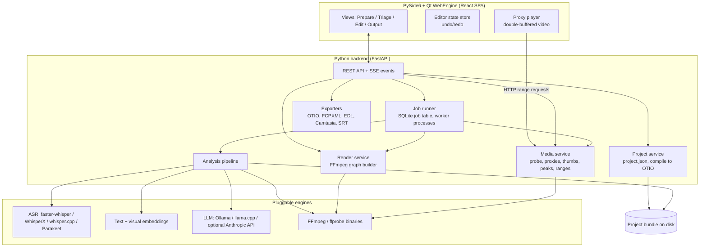

# 03. Architecture

Current architecture: [08](08-review-and-plan.md), [09](09-interactive-editor.md) and [10](10-desktop-shell.md) supersede conflicting historical details below, including job storage, Python version and desktop packaging.

## 1. Overview

Video-Flow is a desktop application: a PySide6 host embeds the React interface in Qt WebEngine, while the Python backend performs media and ML work and serves the trusted editor origin on loopback. Native drag-and-drop and file dialogs pass local path references to the import service without copying originals. Normal launch opens a native window; browser mode is optional for development/diagnostics. See 10 for the bridge, lifecycle and platform gates.



## 2. Decisions

| ID | Decision | Rationale | Alternatives considered |
|----|----------|-----------|-------------------------|
| D-1 | PySide6 + Qt WebEngine desktop window, React UI and Python backend | Native local-path imports without copying; preserves interactive frontend and processing services | Browser mode remains optional for diagnostics; earlier pywebview/Tauri proposals are superseded by 10. |
| D-2 | **Python 3.12 backend (FastAPI, Pydantic v2)** | The whole critical ecosystem is Python: OTIO bindings and adapters, faster-whisper / WhisperX / NeMo, sentence-transformers, PySceneDetect, pyaaf2, Camtasia libraries. One runtime only. | Hono/Node orchestrator + Python worker: reuses TypeScript skills but adds a second runtime, IPC and duplicated schemas. Can be revisited if the backend grows a large non-ML surface. |
| D-3 | React 19 + Vite + TanStack Query + Zustand + shadcn/ui (Radix) | Known stack. TanStack Query for server state, Zustand (with Immer patches) for the latency-sensitive editor state and undo/redo. | Preact (lighter but React Flow and some libs target React) |
| D-4 | Custom canvas timeline, React Flow (xyflow) for the flow overview | Off-the-shelf timeline components do not support branch lanes and word snapping; canvas keeps 300+ clips smooth | `react-timeline-editor` (too limited), PixiJS (only if canvas 2D proves too slow) |
| D-5 | FFmpeg and ffprobe as external CLI binaries via subprocess | Full feature set, easy upgrade, process isolation, progress via `-progress pipe:1` | PyAV bindings (useful for frame access in analysis only) |
| D-6 | OTIO as canonical interchange; `project.json` as source of truth | See 05-data-model.md | OTIO as the only file (take graph squeezed into metadata: possible but awkward to evolve) |
| D-7 | SQLite (WAL) for jobs and analysis index; NumPy `.npy` files for embeddings | Zero-ops, portable inside the project bundle; embeddings counts are small (thousands) so brute-force cosine is enough | sqlite-vec / FAISS (unnecessary at this scale) |
| D-8 | All engines behind interfaces, selected by config and hardware detection | Models evolve fast (ASR and small LLMs change every few months) | Hard-wiring one model |
| D-9 | Local-only by default; cloud LLM provider is opt-in per project | Privacy, offline use | |

## 3. Backend modules

| Module | Responsibility |
|--------|----------------|
| `api/` | FastAPI routers, request/response models, SSE event stream |
| `project/` | Load/save/migrate `project.json`, command log (undo history on disk), compile to OTIO |
| `media/` | ffprobe wrapper, proxy/thumbnail/waveform generation, HTTP range serving of proxies |
| `jobs/` | Persistent job queue (SQLite), worker process pool, cancellation, progress events |
| `analysis/` | Pipeline stages (see 04), stage cache keyed by content hash + stage version + parameters |
| `engines/asr`, `engines/embed`, `engines/vision`, `engines/llm`, `engines/vad` | Engine adapters behind Protocols |
| `render/` | Timeline normalisation, FFmpeg graph builder, presets, loudness passes, render runner |
| `exporters/` | OTIO, OTIOZ, FCPXML (+ auditions post-processor), FCP7 XML, EDL, AAF, Camtasia, SRT/VTT, paper edit |
| `hw/` | Hardware detection: CUDA, Apple MPS/MLX, VideoToolbox/NVENC/QSV/AMF encoders, available RAM |
| `settings/` | Global settings (model paths, cache size) and project settings |

## 4. API surface

REST over JSON, all under `/api`. Long operations return a `job_id`; progress and state changes are pushed on one SSE stream.

| Method | Path | Purpose |
|--------|------|---------|
| POST | `/projects` | Create project from a folder |
| GET | `/projects/{id}` | Project document (beats, takes, sequence, settings) |
| PATCH | `/projects/{id}` | Apply a batch of edit commands (JSON Patch-like, versioned with `base_revision`) |
| POST | `/projects/{id}/assets` | Add files or folders |
| GET | `/assets/{id}` | Probe data, analysis status |
| GET | `/assets/{id}/proxy` | Proxy video (HTTP range) |
| GET | `/assets/{id}/thumbs` | Sprite sheet + index JSON |
| GET | `/assets/{id}/peaks` | Waveform peaks (binary, multi-resolution) |
| GET | `/assets/{id}/transcript` | Words, segments |
| POST | `/projects/{id}/analyse` | Start or resume analysis (optional stage subset, `force` flag) |
| POST | `/projects/{id}/regroup` | Re-cluster with new parameters (fast, no heavy stage) |
| GET | `/beats/{id}/alignment` | Word alignment between takes of a beat |
| POST | `/projects/{id}/preview-render` | Low-res render of a range or of one transition |
| POST | `/projects/{id}/render` | Full render with preset |
| POST | `/projects/{id}/export` | Export to format(s) |
| GET | `/jobs/{id}` / DELETE | Job status / cancel |
| GET | `/events` | SSE: `job.progress`, `job.done`, `asset.updated`, `project.updated` |

Concurrency rule: the browser is the only editor; the backend rejects a PATCH whose `base_revision` is stale (simple optimistic locking, prevents lost updates with two tabs).

Types: Pydantic models are the single source of truth; TypeScript types are generated from the OpenAPI schema (`openapi-typescript`) at build time.

## 5. Job system

- Job table in `analysis.sqlite`: id, kind, asset/project, stage, status, progress, params hash, error, timestamps.
- Worker pool: separate processes (ML libraries hold the GIL and large memory). Pool size from hardware detection; GPU-bound stages serialised on one GPU worker.
- Scheduling order: probe and proxies for all assets first (so the bin becomes usable quickly), then per-asset ASR, then cross-asset stages (relations, clustering) once all assets have their per-asset features.
- Every stage is idempotent and writes its output atomically (temp file + rename). A crash leaves at most one stage to redo.
- Cancellation: cooperative flag checked between chunks; FFmpeg processes are terminated.

## 6. Media handling and preview

### Proxies
- 720p (or 540p for 4K-heavy projects), H.264 8-bit SDR, CFR at project rate, GOP of 12 frames (fast seeking), AAC stereo 48 kHz, `+faststart`.
- HDR sources are tone-mapped in the proxy so the preview looks like the SDR render.
- Rotation baked in. Timestamps preserved so proxy time = source time (no offset), verified at generation.

### Thumbnails and waveforms
- Sprite sheets: one thumbnail per second (160 px wide) + index; denser sprites generated on demand for zoomed views.
- Waveform peaks precomputed at several resolutions (e.g. 100, 400, 1600 samples per second of min/max pairs), stored as binary.

### Playback of the cut
- Two `<video>` elements, double-buffered: while clip N plays, clip N+1 is loaded and seeked to its in point; switch at the cut using `requestVideoFrameCallback` timing.
- Dissolves and fades are previewed with CSS opacity on the two elements; audio crossfade with Web Audio gain nodes.
- Other transitions: the backend renders the transition region (plus 0.5 s around it) at low resolution and the player inserts that short file. Cached by transition parameters hash.
- Known limitation: browser seeking is not strictly frame-accurate; acceptable for preview. The FFmpeg render is the reference.

### Compare view playback
- N players (proxies) started at per-take offsets computed from the alignment anchor; one audio source active at a time (solo), others muted.

## 7. Engine interfaces (sketch)

```python
class AsrEngine(Protocol):
    name: str
    def transcribe(self, wav_path: Path, language: str | None) -> Transcript: ...
    # Transcript: language, words[(text, start, end, prob)], segments[(start, end, text)]

class TextEmbedder(Protocol):
    dim: int
    def embed(self, texts: list[str]) -> np.ndarray: ...   # L2-normalised

class VisualEmbedder(Protocol):
    dim: int
    def embed_frames(self, frames: list[np.ndarray]) -> np.ndarray: ...

class LlmClient(Protocol):
    def complete_json(self, system: str, user: str, schema: dict, max_tokens: int) -> dict: ...

class VadEngine(Protocol):
    def speech_ranges(self, wav_path: Path) -> list[tuple[float, float]]: ...
```

Default engine selection:

| Engine | Apple Silicon | NVIDIA | CPU only |
|--------|---------------|--------|----------|
| ASR | whisper.cpp (Metal) or MLX Whisper, large-v3-turbo; or Parakeet v3 (MLX port) | faster-whisper large-v3-turbo (CUDA) + WhisperX alignment, or Parakeet v3 (NeMo) | Parakeet v3 (ONNX, int8) or faster-whisper `small`/`medium` int8 |
| VAD | Silero VAD | Silero VAD | Silero VAD |
| Text embeddings | paraphrase-multilingual-MiniLM-L12-v2 (chosen by benchmark, see 18) | same | same |
| Visual embeddings | DINOv2-small (near-duplicate shots) | same | same, lower sampling rate |
| LLM | Ollama with a ~2B to 4B instruct model (Gemma 4 E2B/E4B or Qwen3 class) | same | same, smallest size |

Model choices are configuration, not code. Models are downloaded on first use into a shared cache outside project bundles.

## 8. Repository layout

```
videoflow/
├── README.md
├── docs/                      # this specification, ADRs, user guide
├── backend/
│   ├── pyproject.toml         # uv-managed
│   ├── videoflow/
│   │   ├── api/  project/  media/  jobs/  analysis/
│   │   ├── engines/{asr,embed,vision,llm,vad}/
│   │   ├── render/  exporters/  hw/  settings/
│   │   └── cli.py             # `videoflow serve`, `videoflow analyse`, `videoflow render`
│   └── tests/                 # unit + golden-file tests (OTIO, FFmpeg graphs, exports)
├── frontend/
│   ├── package.json           # pnpm
│   └── src/
│       ├── api/               # generated types, TanStack Query hooks
│       ├── state/             # Zustand stores, commands, undo/redo
│       ├── features/{bin,branch-timeline,compare,flow,player,inspector,output}/
│       └── components/ui/     # shadcn
└── samples/                   # tiny test rushes (generated with FFmpeg lavfi + TTS)
```

The CLI is part of the deliverable: `videoflow analyse <folder>` and `videoflow render <project>` work headless, which makes Phase 0 and automated tests possible.

## 9. Runtime requirements

| Item | Requirement |
|------|-------------|
| FFmpeg / ffprobe | 7.0 minimum, 8.x recommended; must include libx264, zimg (`zscale`) for HDR tone mapping; hardware encoders used when present. Path configurable; version checked at startup. |
| Python | 3.12, managed with `uv`; optional extras per engine (`[cuda]`, `[mlx]`, `[cpu]`) |
| Node | Only for building the frontend; the built SPA is served by the backend |
| RAM | 16 GB recommended (8 GB works with smaller models) |
| Disk | Proxies ≈ 1 to 1.5 GB per hour of footage; models 2 to 6 GB shared |

## 10. Security and privacy

- Server binds to `127.0.0.1` only, random port, session token in the launch URL (prevents other local pages from calling the API).
- No outbound network calls except model downloads (explicit) and the optional cloud LLM provider (explicit, per project, with a visible indicator).
- Paths received from the UI are validated against the project's media roots (no arbitrary file read).

## 11. Testing strategy

- **Golden files**: compile fixtures `project.json` → expected `.otio`, expected FFmpeg argument list, expected FCPXML / EDL / tscproj. Diffed in CI.
- **Synthetic media**: test rushes generated with FFmpeg `lavfi` sources plus TTS audio, covering retakes, false starts, simultaneous recordings, VFR and HDR flags.
- **Render checks**: ffprobe duration and stream properties, `ebur128` loudness measurement, frame-hash spot checks at cut points.
- **Grouping benchmark**: a small hand-labelled set from real rushes; pairwise precision/recall tracked per pipeline version (see 04 §11).
- **Interop smoke tests** (manual, per release): open exports in Resolve, Premiere, Final Cut Pro, Kdenlive, Camtasia.
