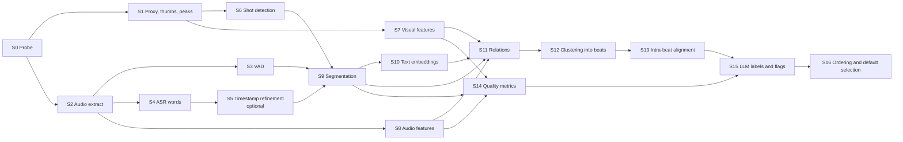

# 04. Analysis pipeline

## 1. Purpose and outputs

The pipeline turns raw assets into a **take graph**:

- per asset: probe data, proxy, thumbnails, waveform peaks, transcript with word timestamps, shots, speech ranges, visual and audio features;
- per segment: text, embeddings, quality metrics, flags;
- across segments: relations (RETAKE, PARTIAL_RETAKE, VISUAL_DUPLICATE, SIMULTANEOUS) with scores, offsets and alignments;
- per beat: member takes, label, summary, role, default selection, order.

Heavy per-asset stages run once and are cached. Cross-asset stages (relations, clustering, ordering) are cheap and re-run whenever the user changes sensitivity or corrects a grouping.

## 2. Stage graph



| Stage | Scope | Tooling (default) | Output | Cost class |
|-------|-------|-------------------|--------|------------|
| S0 Probe | asset | ffprobe JSON | streams, duration, fps/VFR, rotation, colour transfer, creation time | trivial |
| S1 Proxy etc. | asset | FFmpeg | proxy.mp4, sprites, peaks | medium |
| S2 Audio extract | asset | FFmpeg | 16 kHz mono WAV (ASR), 8 kHz mono (sync) | low |
| S3 VAD | asset | Silero VAD | speech ranges | low |
| S4 ASR | asset | Whisper large-v3-turbo or Parakeet TDT 0.6B v3 | words (text, start, end, prob), segments, language | high |
| S5 Refinement | asset | WhisperX forced alignment (wav2vec2 French model) | corrected word times | medium, optional |
| S6 Shots | asset | PySceneDetect AdaptiveDetector (on proxy) | shot boundaries | low |
| S7 Visual | asset | DINOv2-small on frames sampled at 2 fps (proxy), pHash, frame metrics | embeddings `.npy`, per-frame sharpness, luma, motion | medium |
| S8 Audio features | asset | FFmpeg `ebur128`, NumPy | loudness curve, peaks, clipping ratio, noise floor, onset envelope | low |
| S9 Segmentation | asset | Python | speech and visual segments | trivial |
| S10 Text embeddings | segment | multilingual sentence embedder | vectors `.npy` | low |
| S11 Relations | project | NumPy, alignment, FFT cross-correlation | relations table | low to medium |
| S12 Clustering | project | agglomerative clustering with constraints | beats | trivial |
| S13 Alignment | beat | Needleman-Wunsch on tokens, DTW on frame embeddings | anchors, divergence spans | trivial |
| S14 Quality | segment | Python | metrics + score | trivial |
| S15 LLM | beat | Ollama / llama.cpp, JSON schema output | label, summary, role, flags, best take | low to medium |
| S16 Ordering | project | Python | beat order, selected takes | trivial |

**Cache key** for each stage output: `hash(asset_content_hash, stage_name, stage_version, engine_id, model_id, params)`. Changing a model or a parameter invalidates only the affected stages and their dependents.

## 3. Stage details

### S0 Probe
- Read `creation_time` (container tags, Apple QuickTime `com.apple.quicktime.creationdate` when present). Fall back to file modification time, flagged as unreliable.
- Detect VFR (compare `r_frame_rate` with `avg_frame_rate`, sample packet durations).
- Detect HDR (`color_transfer` in `arib-std-b67` (HLG) or `smpte2084` (PQ)).
- Record rotation from display matrix side data.

### S4 ASR
- Language: project setting (default `fr`), auto-detect allowed.
- Whisper tends to clean up disfluencies. To keep fillers visible (needed for quality scoring), use a verbatim-style initial prompt containing typical fillers ("euh, hum, ben, bah...") and keep `condition_on_previous_text` off to limit hallucinated repetitions.
- Long silences: run ASR only on VAD speech ranges padded by 0.3 s to avoid hallucinations on silence, then map times back to asset time.
- Output words with probability; words with very low probability are kept but marked.

### S5 Timestamp refinement (optional)
Whisper word timestamps derived from attention can drift by 100 to 300 ms. When precise word snapping matters, a forced-alignment pass (WhisperX with a French wav2vec2 model) corrects them. Parakeet TDT produces usable word timestamps natively, so S5 is skipped with that engine.

### S9 Segmentation
Two segment kinds:

**Speech segments (one attempt at saying something)**
1. Utterances: consecutive words split where the inter-word gap > 0.8 s, or sentence-final punctuation followed by a gap > 0.4 s.
2. Blocks: consecutive utterances merged until a gap > 2.0 s, a shot boundary with a gap > 0.5 s, or a **restart** is detected: the next utterance aligns strongly with the beginning of the current block (lexical coverage of its first N words ≥ 0.7). Restarts are how consecutive retakes inside one file are separated.
3. Bounds: `start = first_word.start`, `end = last_word.end`; editing padding is applied later, not stored in the segment.

**Visual segments (non-speech shots)**
- Shots from S6 intersected with non-speech ranges; keep ranges ≥ 1.5 s. Long static shots are split every 20 s to keep segments comparable.

Each segment stores the list of shot ids it overlaps (a speech segment can span shots).

### Text normalisation (French first)
Lowercase, Unicode NFKC, accent-insensitive comparison key, punctuation removed, elisions split (`l'appareil` → `l appareil`), numbers normalised to digits, fillers tagged (not removed) so they can be ignored in matching but counted in quality. Filler lexicon configurable per language.

## 4. Relation detection (S11)

### 4.1 Text similarity (speech segments)
For each pair (a, b):

1. Pre-filter: cosine of text embeddings ≥ 0.45 (cheap, removes most pairs).
2. Align normalised tokens (fillers excluded) with Needleman-Wunsch: match if tokens equal or fuzzy ratio ≥ 0.85, mismatch and gap penalties configurable.
3. Compute `matched`, `cov_a = matched / len(a)`, `cov_b = matched / len(b)`, `lex = 2·matched / (len(a) + len(b))`.
4. `text_sim = 0.6·lex + 0.4·cosine`.

Classification:
- **RETAKE**: `text_sim ≥ θ_text` (default 0.55) and `min(cov_a, cov_b) ≥ 0.5`.
- **PARTIAL_RETAKE**: shorter segment ≤ 0.6 × longer length, its coverage ≥ 0.8, matches form a contiguous prefix or suffix of the longer one. The shorter one is a candidate false start.

### 4.2 Visual similarity
- Each segment is a sequence of frame embeddings (2 fps). `vis_sim(a, b)` = mean over frames of `a` of the best cosine match in `b`, symmetrised (average of both directions). DTW is used later for alignment, not for scoring.
- **VISUAL_DUPLICATE**: `vis_sim ≥ θ_vis` (default 0.85 with DINOv2-small) and (both segments non-speech, or `text_sim < θ_text`). This covers "same visual, different audio".
- pHash distance is used as a fast exact-ish duplicate check (identical shots from duplicated exports).

### 4.3 Simultaneous recordings (multicam, "same audio, different video")
1. Candidate asset pairs: recording windows `[creation_time, creation_time + duration]` overlap, with ±10 min tolerance for camera clock drift. Without creation times: all pairs, after a fingerprint pre-filter.
2. Cross-correlate the 8 kHz onset envelopes with FFT (GCC-PHAT weighting). Accept if the normalised peak ≥ θ_sync (default 0.3) and peak-to-sidelobe ratio ≥ 4.
3. Refine the offset to the millisecond on a 1 s window at full sample rate.
4. Store the asset-level offset; segments that overlap in synchronised time get a **SIMULTANEOUS** relation and are merged into a **sync group** before clustering.

### 4.4 Relations table
`(segment_a, segment_b, type, score, details)` where `details` holds coverages, offsets and the alignment path. Stored in SQLite; recomputed only for new segments when assets are added.

## 5. Clustering into beats (S12)

```text
nodes   = speech segments ∪ visual segments
contract sync groups into single nodes                       # SIMULTANEOUS
contract user must-link pairs
edges   = RETAKE / PARTIAL_RETAKE (weight text_sim),
          VISUAL_DUPLICATE (weight vis_sim)
remove edges for user cannot-link pairs
distance = 1 - weight (missing edge = 1.0)
clusters = agglomerative(distance, linkage="average", threshold=τ)
for each cluster:
    if it violates a cannot-link -> split along the weakest link
beats    = clusters
orphans  = singleton clusters flagged noise (duration < 1 s, mean ASR prob < 0.4,
           or LLM role == off_topic after S15)
```

- `τ` is driven by the **sensitivity slider** (ANA-10): left = only near-identical takes grouped, right = loose grouping. Re-clustering takes milliseconds.
- Speech and visual segments are clustered in one graph but edges only exist within a kind, so beats are either speech beats or visual beats. Visual beats are candidates for B-roll.
- User corrections (move take, merge, split) are stored as must-link / cannot-link constraints and survive any re-run.

## 6. Intra-beat alignment (S13)

Purpose: draw alternates under the main line so that equivalent content lines up, and drive synchronised playback in the compare view.

- **Speech beats**: reference = selected take. Each other take is aligned token by token to the reference (same Needleman-Wunsch as §4.1). Output: anchors `[(t_ref, t_take)]` at matched word starts, and divergence spans (unmatched tokens on either side). Lane offset in the branch timeline = `t_ref(first anchor) - t_take(first anchor)`.
- **Visual beats**: DTW over frame embedding sequences gives the warping path; the offset is taken at the first strong match.
- **Sync groups**: offset known from §4.3, exact.
- Alignment is recomputed when the selected take changes (cheap).

## 7. Quality metrics and score (S14)

| Metric | Source | Notes |
|--------|--------|-------|
| completeness | alignment against beat consensus (tokens present in ≥ half of the takes) | main driver for speech takes |
| filler rate | tagged fillers per 10 words + unexplained voiced gaps (VAD speech without words) | catches fillers that ASR dropped |
| false start | PARTIAL_RETAKE shorter side, LLM flag | strong penalty |
| speech rate, long pauses | word timings | outliers penalised mildly |
| ASR confidence | mean word probability | proxy for articulation and noise |
| loudness, clipping, noise floor | S8 | in-range loudness, clipping ratio < 0.1 % |
| sharpness | variance of Laplacian on sampled frames | relative within the beat |
| exposure | mean luma, clipped highlights/shadows ratio | |
| shake | frame-to-frame motion energy | relative within the beat |
| recency | is the last take of the beat by recording time | creators usually nail the last take |

Score in [0, 1], default weights: completeness 0.30, fluency 0.20, audio 0.15, video 0.15, confidence 0.10, recency 0.10; false start multiplies the score by 0.3. Video metrics are normalised **within the beat** (comparison between takes of the same scene, not absolute quality). The inspector shows the breakdown so the suggestion is explainable. Weights are user-editable in settings.

## 8. Local LLM tasks (S15)

The LLM runs **once per beat**, on small inputs, after clustering. It never decides grouping on its own.

### Input (per beat)
```json
{
  "language": "fr",
  "beat_id": "b07",
  "context": {"previous_label": "Ouverture de la boîte", "next_label": null},
  "takes": [
    {"take_id": "s031", "duration": 14.2, "text": "Dans la boîte on trouve le câble USB-C et le chargeur 65 W", "heuristic_flags": []},
    {"take_id": "s044", "duration": 4.1, "text": "Alors dans la... attends je reprends", "heuristic_flags": ["partial_retake"]}
  ]
}
```
Texts are truncated to ~400 characters per take; at most 8 takes per call (longest and best-scored first).

### Output schema (enforced with constrained decoding, validated with Pydantic)
```json
{
  "label": "string, max 48 chars, project language",
  "summary": "string, max 160 chars",
  "role": "intro | content | transition | outro | off_topic",
  "takes": [{"take_id": "string", "false_start": "boolean", "off_topic": "boolean", "note": "string, max 80 chars"}],
  "best_take_id": "string or null",
  "reason": "string, max 120 chars"
}
```

Rules: temperature 0, one retry on validation failure, then fallback (label = top keywords by TF-IDF across the beat, no flags). The LLM's `best_take_id` is a tie-breaker input to S16, not an override of the score.

### Optional global pass (P1)
A single call with the ordered list of beat labels and roles asks for a suggested narrative order (typical case: intro recorded at the end). The result is shown as a suggestion, never applied silently.

### Providers
Local by default (Ollama or llama.cpp server, ~2B to 4B instruct model). An Anthropic API provider can be enabled per project for better labels on long projects; the payload is the same (text only, no media).

## 9. Ordering and default selection (S16)

- **Default order**: by the recording time of each beat's earliest complete take (asset creation time + segment start; sync-corrected). Fallback without creation times: natural sort of file names, then segment start.
- Beats with LLM role `intro` / `outro` are moved first / last if they are not already, as a suggestion flagged in the UI.
- **Default selection**: highest score; ties broken by LLM best take, then by recency.
- Visual beats are placed by recording time on the main line by default; the user can convert them to B-roll over a chosen beat.

## 10. Re-analysis and corrections

| User action | What re-runs |
|-------------|--------------|
| Sensitivity slider | S12, S13, S16 (ms) |
| Move / merge / split beat | constraints updated, S12 to S16 for affected beats |
| Change selected take | S13 for that beat |
| Edit transcript text (P1) | S10, S11 for that segment, S12 to S16 |
| Add assets | S0 to S10 for new assets, S11 for pairs involving them, S12 to S16 |
| Change ASR engine or model | everything from S4 for all assets (explicit confirmation) |

User-made selections and manual beat edits are never overwritten by re-analysis.

## 11. Evaluation protocol (Phase 0 and regression)

- Ground truth: 2 to 3 real unboxing projects annotated by hand (segment → beat id, best take per beat).
- Metrics: pairwise precision / recall / F1 on "same beat" pairs, B-cubed F1, **correction cost** (number of move/merge/split operations to reach ground truth), default-selection agreement.
- MVP targets: pairwise F1 ≥ 0.85 on speech segments, ≥ 0.70 on visual segments, ≤ 1 correction per 5 beats, default selection agreement ≥ 60 %.
- Thresholds (`θ_text`, `θ_vis`, `θ_sync`, `τ`) are tuned on this set and frozen per pipeline version.

## 12. Performance budget (1 hour of 1080p/4K footage, accelerated laptop)

| Stage | Target |
|-------|--------|
| S0 to S2 | < 1 min |
| S1 proxies | < 6 min (hardware encoder) |
| S4 ASR | < 5 min |
| S6 + S7 | < 4 min |
| S9 to S16 | < 1 min (LLM included, ~15 to 30 beats) |
| **Total** | **< 15 min**, bin usable after ~2 min, triage usable as soon as S12 completes |
